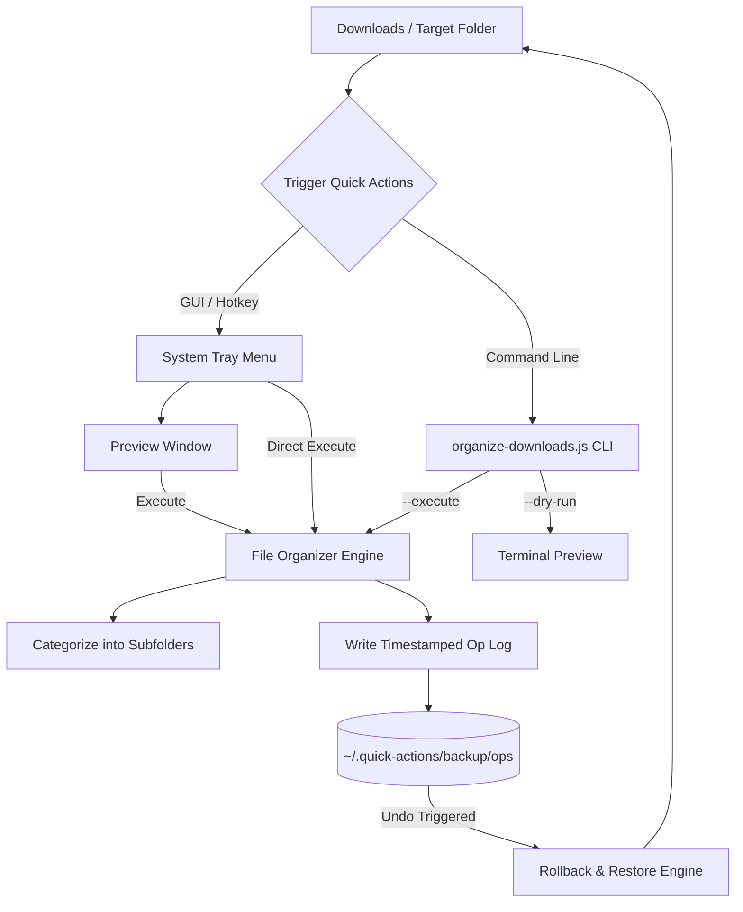

# Quick Actions Tray 🚀

[](https://www.electronjs.org/)
[](https://nodejs.org/)
[](https://opensource.org/licenses/ISC)
[](#)

A fast, lightweight system tray utility and standalone CLI tool that keeps your **Downloads** folder (or any custom directory) neat, structured, and organized. Features an interactive dry-run preview, customizable categorization rules, global hotkey support, and a non-destructive undo engine with collision protection.

---

## Table of Contents

- [Key Features](#key-features)
- [How It Works](#how-it-works)
- [Project Structure](#project-structure)
- [Prerequisites & Installation](#prerequisites--installation)
- [Usage](#usage)
  - [System Tray Application](#1-system-tray-application)
  - [Standalone CLI Tool](#2-standalone-cli-tool)
- [Configuration](#configuration)
  - [Default File Rules](#default-file-rules)
  - [Config File Location & Options](#config-file-location--options)
- [Safety & Undo Engine](#safety--undo-engine)
- [Roadmap & Enhancements](#roadmap--enhancements)
- [License](#license)

---

## Key Features

- **Desktop System Tray Integration**: Sits discreetly in your system tray ready for quick access without cluttering your taskbar.
- **Interactive Dry-Run Preview Window**: Review planned moves grouped by categories before executing anything. Trigger the move directly from the preview window with a single click.
- **One-Click Execute & Undo**: Execute sorting on demand and safely rollback any organization operation if you change your mind.
- **Collision-Safe Renaming**: Never overwrites existing files. Automatically detects duplicate names and appends increments like `file (1).ext` or `file (restored 1).ext`.
- **Global Hotkey Support**: Instantly summon the Quick Actions menu anywhere via `Ctrl+Alt+O` (`Cmd+Alt+O` on macOS).
- **GUI Preferences Editor**: Built-in settings window to manage target folders, backup directories, recursive scans, preview limits, and JSON categorization rules.
- **Dual-Mode (GUI + CLI)**: Use the Electron desktop interface or run headless via the pure Node.js CLI script with **zero external runtime dependencies**.

---

## How It Works



---

## Project Structure

```text
quick-actions-tray/
├── .gitignore              # Git ignore configuration
├── package.json            # Project manifest, scripts, and dependencies
├── package-lock.json       # Locked dependency graph
├── main.js                 # Electron main process (Tray, Windows, IPC, Hotkeys)
├── configHelper.js         # Configuration manager and defaults handler
├── organize-downloads.js   # Standalone CLI and core file organization engine
├── tray-icon.png           # System tray status icon
└── README.md               # Project documentation
```

### Component Overview

| File | Role |
| :--- | :--- |
| **`main.js`** | Electron application entry point. Handles system tray lifecycle, native context menus, global shortcuts, notifications, preferences modal, and HTML dry-run preview window. |
| **`organize-downloads.js`** | Core sorting engine. Can be run directly as a CLI tool. Implements file scanning, rule matching, collision resolution, batch renaming, operation logging, and undo rollback. |
| **`configHelper.js`** | Manages persistent user preferences stored under `~/.quick-actions/config.json`. |

---

## Prerequisites & Installation

### Prerequisites

- **Node.js**: Version 16.x or newer ([Download Node.js](https://nodejs.org/))
- **npm**: Bundled with Node.js

### Installation

1. **Clone the repository**:
   ```bash
   git clone https://github.com/<your-username>/quick-actions-tray.git
   cd quick-actions-tray
   ```

2. **Install dependencies**:
   ```bash
   npm install
   ```

---

## Usage

### 1. System Tray Application

Start the tray application:
```bash
npm start
```

Once running:
- A tray icon appears in your notification area / taskbar tray.
- **Left-click or Right-click** the tray icon to open the context menu:
  - **Preview: Organize Downloads**: Opens an HTML preview window categorizing files into their proposed destinations. Click **Execute** in the preview to confirm.
  - **Execute: Organize Downloads**: Runs file organization immediately and sends a native system notification upon completion.
  - **Undo last organize**: Reverses the previous operation and returns files to their source folders.
  - **Preferences**: Opens the settings dialog to customize rules, targets, hotkeys, and flags.
  - **Open op logs**: Opens the folder containing JSON operation logs in your file manager.
  - **Quit**: Exits the background tray application.
- **Global Shortcut**: Press `Ctrl+Alt+O` (`Cmd+Alt+O` on macOS) anytime to pop up the tray menu.

---

### 2. Standalone CLI Tool

You can run the organizer directly from terminal or schedule it with Task Scheduler (Windows) or cron (macOS/Linux) without running Electron:

```bash
# Preview planned changes without touching files (Dry Run)
node organize-downloads.js --dry-run

# Execute organization on default target directory
node organize-downloads.js --execute --yes

# Organize a specific custom folder
node organize-downloads.js --target "D:/MyProjects/MessyFolder" --execute --yes

# Undo the last operation
node organize-downloads.js --undo

# Display help and all available options
node organize-downloads.js --help
```

#### CLI Options Reference

| Option | Shorthand | Description | Default |
| :--- | :--- | :--- | :--- |
| `--target <path>` | — | Specify directory to organize | `~/Downloads` |
| `--dry-run` | — | Display planned moves and skipped files | Enabled by default |
| `--execute` | — | Perform file moves and record operation log | `false` |
| `--yes`, `--force`| — | Bypass execution confirmation prompt | `false` |
| `--undo` | — | Revert moves from the most recent operation log | `false` |
| `--verbose` | — | Output verbose execution details | `false` |
| `--help` | `-h` | Show CLI usage documentation | — |

---

## Configuration

Preferences are stored in your user home directory at:
```text
~/.quick-actions/config.json
```

### Default File Rules

Files matching the extensions below are moved into their respective subfolders:

| Category | File Extensions |
| :--- | :--- |
| **Images** | `.jpg`, `.jpeg`, `.png`, `.gif`, `.webp` |
| **Documents** | `.pdf`, `.doc`, `.docx` |
| **Text** | `.txt` |
| **Data** | `.csv` |
| **Archives** | `.zip`, `.rar`, `.7z`, `.gz` |
| **Videos** | `.mp4`, `.mkv` |
| **Audio** | `.mp3` |

### Config File Location & Options

Edit via the GUI **Preferences** menu or directly edit `~/.quick-actions/config.json`:

```json
{
  "targetFolder": "C:\\Users\\User\\Downloads",
  "backupFolder": "C:\\Users\\User\\.quick-actions\\backup",
  "rules": {
    ".pdf": "Documents",
    ".docx": "Documents",
    ".png": "Images",
    ".zip": "Archives"
  },
  "recursive": false,
  "autoYes": false,
  "previewLimit": 200,
  "enableHotkey": true
}
```

#### Configuration Fields

- **`targetFolder`** *(string)*: Absolute path to the directory that should be scanned and organized.
- **`backupFolder`** *(string)*: Location where operation logs (`/ops`) and backup data are maintained.
- **`rules`** *(object)*: Map of lowercase file extension (including dot, e.g., `".pdf"`) to subfolder name.
- **`recursive`** *(boolean)*: If `true`, scans subdirectories recursively. If `false`, only processes top-level files in `targetFolder`.
- **`autoYes`** *(boolean)*: If `true`, skips interactive confirmation prompts during execution.
- **`previewLimit`** *(number)*: Maximum number of filenames to render in preview tables before summarizing.
- **`enableHotkey`** *(boolean)*: Toggle the global `Ctrl+Alt+O` / `Cmd+Alt+O` shortcut on or off.

---

## Safety & Undo Engine

Quick Actions is engineered to prevent accidental data loss:

1. **Non-Destructive Batch Move**: Moves files via standard file-system renames without modifying file contents or metadata.
2. **Atomic Collision Handling**: If a file with the same name already exists in the target category folder, Quick Actions resolves collisions by naming it `filename (1).ext`, `filename (2).ext`, etc.
3. **Structured JSON Operation Logs**: Every execution generates an immutable audit record in `~/.quick-actions/backup/ops/` containing timestamp, operation ID, source paths, and destination paths.
4. **Intelligent Undo**:
   - Reads the latest log in reverse order.
   - Moves files back to their original source locations.
   - If a new file now occupies the original location, it safely restores as `filename (restored 1).ext`.
   - Renames the log to `.undone.json` to prevent re-undo cycles.

---

## Roadmap & Enhancements

- [ ] Add option to pack standalone executable via `pkg` or `electron-builder`
- [ ] Migrate preview window to modern Electron IPC security (`contextBridge` + preload script)
- [ ] Add date-based organization rules (e.g., sort by Year/Month)
- [ ] Add regex pattern matching for filename-based sorting rules

---

## License

This project is licensed under the [ISC License](https://opensource.org/licenses/ISC). See the `LICENSE` file for details.

